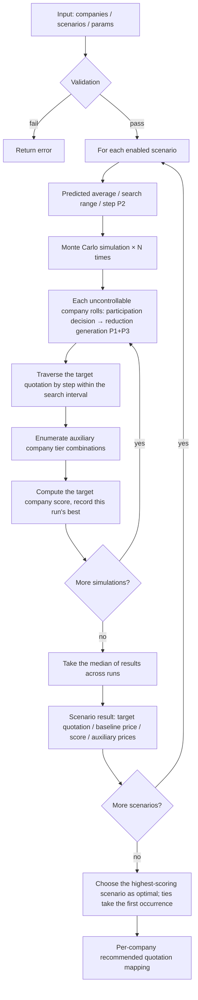

# Quotation Calculation — Calculation Process

This document describes in detail the complete calculation logic of this plugin. The algorithm is ported line by line from the TenderOptimizer Python version, taking the implementation code as the single source of truth; a list of differences from the Python version is given at the end.

## 1. System Overview

Based on market price-reduction assumptions, a competitive environment is constructed through **Monte Carlo simulation** (100 runs by default), to find the highest-scoring second-round quotation scheme for the target company, while also providing the auxiliary companies' supporting quotations.

- The calculation engine lives on the Rust side (`plugins/tender-optimizer/backend/engine.rs`); data is passed in from the frontend, and it is a stateless pure function
- Results are deterministic and reproducible: each simulation uses a fixed seed `seed + sim` (seed = 42)
- Aggregation: the **median** of the simulation results is taken as the recommended value (more robust than the mean)

## 2. Core Concepts

### 2.1 Company Types

| Type                   | Code | Description                                                                                 |
| ---------------------- | ---- | ------------------------------------------------------------------------------------------- |
| Target company         | T    | The company whose quotation is to be optimized; **there is exactly 1** (hard requirement)   |
| Auxiliary company      | A    | A company whose quotation can be controlled, used to help raise/stabilize the average price |
| Uncontrollable company | U    | A competitor; its quotation fluctuates randomly according to the scenario assumptions       |

### 2.2 Company Behavior Model (P3)

| Behavior     | Reduction factor (default)          | Description                                                                         |
| ------------ | ----------------------------------- | ----------------------------------------------------------------------------------- |
| aggressive   | 1.3                                 | Reduces price 30% more than average                                                 |
| normal       | 1.0                                 | Equal to the average reduction (**also treated as normal when no behavior is set**) |
| conservative | 0.5                                 | Reduces 50% less than average                                                       |
| auto         | Graded by quotation/price-cap ratio | See the table below                                                                 |

Automatic grading rules (`ratio = first-round quotation / tax-inclusive price cap`):

| ratio range  | Factor                                       |
| ------------ | -------------------------------------------- |
| > 0.98       | Aggressive factor                            |
| (0.95, 0.98] | Normal + (aggressive − normal) × 0.5         |
| (0.90, 0.95] | Normal factor                                |
| (0.85, 0.90] | Conservative + (normal − conservative) × 0.5 |
| ≤ 0.85       | Conservative factor                          |

### 2.3 Calculation Scenarios

| Field              | Description                                                                                                                |
| ------------------ | -------------------------------------------------------------------------------------------------------------------------- |
| Reduction mode     | `percent` percentage / `amount` value (10k yuan)                                                                           |
| Reduction value    | A **negative number** indicates a price reduction (e.g. -0.05 = 5% reduction, -0.5 = 0.5 × 10k yuan reduction)             |
| Participation rate | 0–1, the probability that each uncontrollable company participates in the price reduction                                  |
| Standard deviation | Gaussian fluctuation amplitude of the reduction; 0 = no explicit fluctuation (there is still implicit fluctuation, see P1) |
| Enabled            | Only enabled scenarios participate in the calculation                                                                      |

### 2.4 Scoring Parameters (Default Values)

| Parameter                              | Default            | Meaning                                                                                     |
| -------------------------------------- | ------------------ | ------------------------------------------------------------------------------------------- |
| W1                                     | -0.15              | Lower bound of the valid interval (within 15% below A1)                                     |
| W2                                     | 0.10               | Upper bound of the valid interval (within 10% above A1)                                     |
| C                                      | 0                  | Baseline price fluctuation coefficient (**baseline price = valid average price × (1 − C)**) |
| n1                                     | 1.0                | Penalty coefficient when quotation ≥ baseline price                                         |
| n2                                     | 0.5                | Penalty coefficient when quotation < baseline price                                         |
| Aggressive/normal/conservative factors | 1.3 / 1.0 / 0.5    | P3 behavior factors                                                                         |
| Minimum auxiliary price difference     | 0.02 × 10k yuan    | The minimum difference between auxiliary companies' quotations                              |
| Simulation count                       | 100 (range 1–2000) | Number of Monte Carlo simulations                                                           |

> Note: the baseline price formula is `× (1 − C)` (implementation is authoritative). When C = 0 the baseline price = valid average price;
> when C > 0 the baseline price is **lower than** the valid average price. The `× (1 + C)` form in older docs does not match the implementation.

## 3. Scoring Rules

### 3.1 Average Price A1 After Removing the Highest and Lowest

The number of "high removals / low removals" is determined by the number of bidders M:

| M     | Remove highest | Remove lowest |
| ----- | -------------- | ------------- |
| ≤ 5   | 0              | 0             |
| 6–10  | 1              | 1             |
| 11–20 | 2              | 1             |
| 21–30 | 2              | 2             |
| > 30  | 4              | 3             |

`A1 = average of the remaining quotations after removing the highest and lowest`

### 3.2 Valid Bidder Determination

The valid interval is a **closed interval**:

```
[A1 × (1 + W1), A1 × (1 + W2)]
```

A company whose quotation falls within the interval is a valid bidder. If no one falls in the interval, it falls back to
"the remaining bidders after removal by the high/low removal rules".

### 3.3 Baseline Price

```
baseline price = valid bidders' average price × (1 − C)
```

### 3.4 Price Score (100-point scale)

```
score = 100 − 100 × n × |quotation − baseline price| / baseline price     (lower bound 0)
n     = quotation ≥ baseline price ? n1 : n2
```

- When `n1 > n2`, being slightly below the baseline price is more favorable (encourages lower prices)
- When `n1 = n2`, the closer to the baseline price the better
- A deviation that is too large clamps the score to 0

## 4. The Three Main Features

### P1: Reduction Standard Deviation

The actual reduction of each uncontrollable company is generated independently:

```
actual reduction = scenario reduction × behavior factor (P3) + gauss(0, σ)
σ = standard deviation                        (when standard deviation > 0)
σ = |scenario reduction| × 0.15 (percentage mode) / × 0.10 (value mode)   (implicit fluctuation when standard deviation = 0)
```

Second-round quotation:

```
percentage mode: new quotation = first-round quotation × (1 + actual reduction)
value mode:      new quotation = first-round quotation + actual reduction
new quotation = max(0.01, new quotation), then rounded to 4 decimal places
```

Each company rolls independently in **each simulation**: first determine participation
(`random number < participation rate`; if not participating, the first-round quotation is kept), and only after participating is the reduction generated.

**Example** (following the original document): an uncontrollable company's first round is 18.7 × 10k yuan, aggressive (×1.3),
scenario "percentage -5% ±1.5%, participation rate 80%". Assume it participates:

```
base reduction = -5% × 1.3 = -6.5%
random fluctuation = gauss(0, 1.5%) ≈ +0.8%
actual reduction = -5.7%
new quotation = 18.7 × (1 - 5.7%) ≈ 17.65 × 10k yuan
```

### P2: Adaptive Search Range

**Predicted market average price**: the average of the uncontrollable companies' first-round quotations directly converted by the scenario reduction
(excluding random fluctuation and behavior factors).

**Search range**:

```
standard deviation > 0: range = standard deviation × 2.5           (in percentage mode, further × target first-round price)
standard deviation = 0: range = |scenario reduction| × 0.5       (in percentage mode, further × target first-round price)
```

**Search step** (proportional to the lot price):

```
step = first-round quotation × 0.02%, clamped to [0.001, 0.05] × 10k yuan (10 yuan ~ 500 yuan)
≥ 0.01 × 10k yuan takes 2 decimal places, otherwise 3
```

| Lot price      | Step               | Search range (approx.) | Iterations (approx.) |
| -------------- | ------------------ | ---------------------- | -------------------- |
| 20 × 10k yuan  | 40 yuan            | ±0.75 × 10k yuan       | ~375                 |
| 50 × 10k yuan  | 100 yuan           | ±1.88 × 10k yuan       | ~375                 |
| 100 × 10k yuan | 200 yuan           | ±3.75 × 10k yuan       | ~375                 |
| 500 × 10k yuan | 500 yuan (clamped) | ±18.75 × 10k yuan      | ~750                 |

**Search interval**: the target company's quotation traversal range =

```
[0.88 × first-round quotation, first-round quotation] ∩ [predicted average − search range, predicted average + search range]
```

When the intersection is empty, it falls back to `[0.88 × first-round quotation, first-round quotation]`.

### P3: Company Behavior Model

See 2.2. Where it applies: it only affects the simulated reduction of **uncontrollable companies** (`scenario reduction × behavior factor`).

## 5. Complete Calculation Flow



### 5.1 Finding the Optimal Quotation Within a Single Simulation

1. Fix the board with the uncontrollable companies' quotations generated in this simulation
2. Traverse the target quotation from the lower search bound to the upper bound by step
3. Auxiliary company quotations take fixed tier combinations near the price cap:
   - 1 auxiliary: choose one of four from `price cap × [99.5%, 99%, 98.5%, 98%]`
   - 2 auxiliaries: one of four from tier A × one of four from tier B (`price cap × [97.5%, 97%, 96.5%, 96%]`),
     and skip combinations where `|A − B| < minimum price difference`
   - ≥ 3 auxiliaries: the first 2 are enumerated as the combinations above, the rest are fixed at `price cap × 98%`
4. For each combination, compute the full set of quotations once → baseline price → target company score
5. The combination with a strictly higher score wins (ties keep the first occurrence)

### 5.2 Result Aggregation

| Field                                   | How the value is taken                                        |
| --------------------------------------- | ------------------------------------------------------------- |
| Target quotation                        | **Median** of the optimal target prices across simulations    |
| Baseline price                          | **Median** of the baseline prices across simulations          |
| Score                                   | **Median** of the target scores across simulations            |
| Auxiliary company quotations            | The auxiliary combination from the highest-scoring simulation |
| Predicted average / search range / step | Scenario-level constants (P2)                                 |

Optimal scenario = the highest-scoring of the scenarios (ties take the scenario that appears first).

### 5.3 Recommended Quotation Mapping

| Company type     | Recommended quotation                                                                       |
| ---------------- | ------------------------------------------------------------------------------------------- |
| Target T         | The target quotation of the optimal scenario                                                |
| Auxiliary A      | The value at the corresponding position in the optimal scenario's auxiliary quotation array |
| Uncontrollable U | None (not recommended)                                                                      |

`change = recommended quotation − first-round quotation`.

## 6. Numerical Details

- All simulated prices and results are uniformly rounded to **4 decimal places** (in 10k yuan, i.e. 0.1 yuan precision)
- Random call order for participation determination and Gaussian fluctuation: for each company "determine first, fluctuate after",
  consistent with the Python version, ensuring the algorithm structure is equivalent
- The simulation count is adjustable (1–2000), default 100; the more runs, the more robust the median, and the time cost grows linearly

## 7. Differences from the Original Python Version

The following differences are all **intentional or statistically insignificant**, described one by one:

| #   | Difference                                           | Description                                                                                                                                                                                                                                                                                        |
| --- | ---------------------------------------------------- | -------------------------------------------------------------------------------------------------------------------------------------------------------------------------------------------------------------------------------------------------------------------------------------------------- |
| 1   | Different random number stream                       | Rust `StdRng(seed+sim)` and CPython MT19937 have the same statistical distribution but different sequences; the values for the same input are **not bit-for-bit identical** (the distribution and median properties are consistent); the seed strategy (42+sim) and call order are kept consistent |
| 2   | round semantics                                      | Python `round()` is round-half-to-even (banker's rounding), Rust is round-half-away-from-zero; only theoretical boundary values (such as exactly 0.00005) are affected                                                                                                                             |
| 3   | arange generation                                    | numpy `arange` generates the equally spaced point sequence by multiplication, Rust by accumulation; long sequences have a drift on the order of ~1e-13, with no practical effect on the median                                                                                                     |
| 4   | Degenerate scenario with no uncontrollable companies | Python's predicted average is nan; Rust's is 0 → the search interval falls back to the full bound `[0.88r1, r1]` (Rust's behavior is more robust)                                                                                                                                                  |
| 5   | First-round quotation > price cap                    | Consistent with Python: keep with a warning on import, and the calculation proceeds as usual (no hard block)                                                                                                                                                                                       |
| 6   | Import has no cross-statement transaction            | The framework's db channel does not yet support transactions; a failure mid-import may leave partial working-set data (the data volume is small, so the risk is acceptable)                                                                                                                        |
| 7   | Reduction display text                               | The display layer shows `-5.0%` without an explicit `+` sign (Python shows `+5.0%`), affecting display only                                                                                                                                                                                        |

## 8. Data Flow Architecture

```
┌───────────────────────────────── Frontend (Vue) ─────────────────────────────────┐
│ Calculator.vue                                                                   │
│  ├─ Working set editing → kdb (tender_companies / tender_scenarios               │
│  │                / tender_params, inline edits are persisted immediately)       │
│  ├─ Import template → ipc(import_template, path+planName)                        │
│  │            → calamine parse → replace the whole working set → reload          │
│  ├─ Run calculation → ipc(calculate, companies+scenarios+params)                 │
│  │            → result display + kdb write to tender_history archive             │
│ History.vue                                                                      │
│  ├─ List / detail ← kdb (tender_history)                                         │
│  └─ Export → ipc(export_result, payload+path)                                    │
│             → rust_xlsxwriter writes a styled workbook                           │
└──────────────────────────────────────────────────────────────────────────────────┘
            ↕ IPC(command params camelCase, struct fields snake_case)
┌────────────────────────────────────── Rust ──────────────────────────────────────┐
│ mod.rs        Command layer: validation / orchestration / recommendation mapping │
│ engine.rs     Pure-function engine: simulation + search + median aggregation     │
│ excel.rs      calamine reads templates / rust_xlsxwriter writes results          │
│ models.rs     Data structures + behavior factors                                 │
│ db (sqlx)     SQLite: 3 working-set tables + 1 history table (migrations v3–v7)  │
└──────────────────────────────────────────────────────────────────────────────────┘
```

## 9. Validation Rules

### Import (excel.rs; warns and skips invalid rows)

| Situation                                             | Handling                         |
| ----------------------------------------------------- | -------------------------------- |
| Company name is empty                                 | Skip the row                     |
| Quotation / price cap is not numeric                  | Warn + skip                      |
| Quotation / price cap ≤ 0                             | Warn + skip                      |
| First-round quotation > price cap                     | Warn only (kept for calculation) |
| Type is not T/A/U                                     | Warn + skip                      |
| Company behavior is not one of the four enum values   | Warn + clear (treated as normal) |
| Reduction mode is not percentage/value                | Warn + skip                      |
| Participation rate not in 0–1 / reduction is positive | Warn only (kept)                 |
| Standard deviation is negative                        | Warn + set to 0                  |
| Scoring-parameter sheet missing                       | Use default parameters           |
| Company / scenario sheet missing or company is empty  | **Error**                        |

### Calculation (mod.rs validate, hard errors)

| Situation                          | Handling |
| ---------------------------------- | -------- |
| Company name is empty              | Error    |
| Quotation / price cap ≤ 0          | Error    |
| Number of target companies ≠ 1     | Error    |
| No enabled scenario                | Error    |
| All scenarios have no valid result | Error    |
